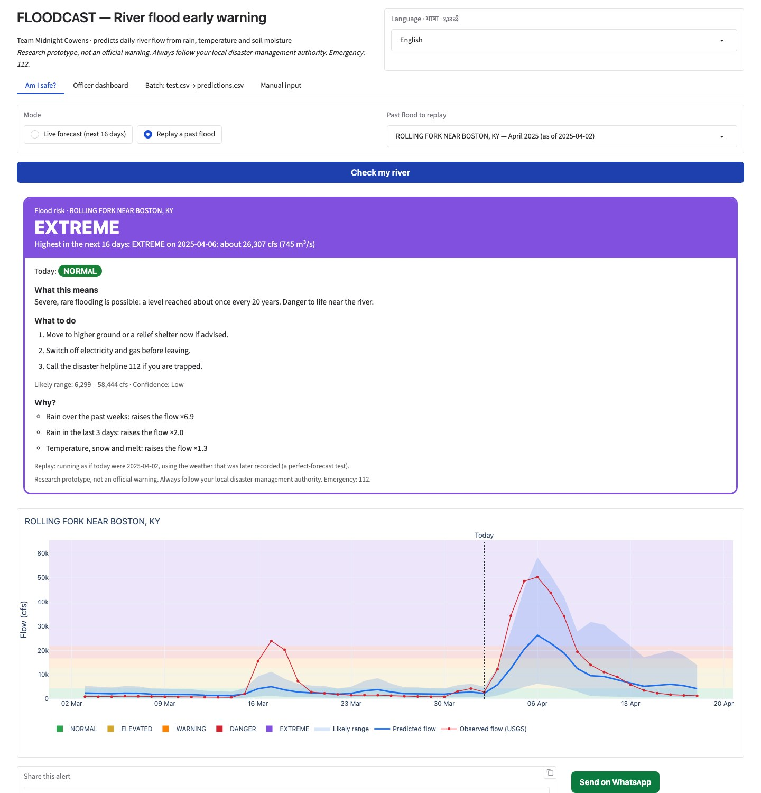
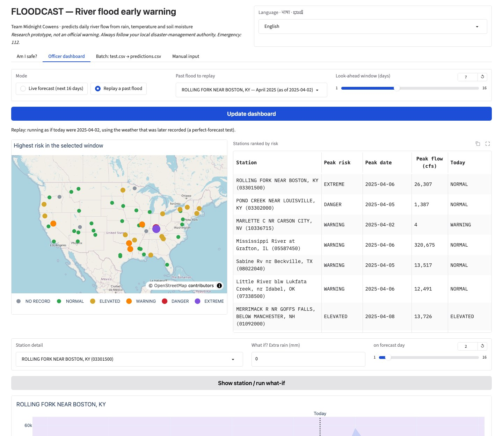

# FLOODCAST — Team Midnight Cowens

Predicts **daily river discharge (cubic feet per second)** at USGS river stations from rainfall,
temperature, soil moisture and catchment attributes, following the FLOODCAST problem statement.
On top of the model sits an **early-warning app**. It turns cfs into a flood risk level people can
act on, up to 16 days ahead, in **English, Hindi and Kannada**.

> **Setting this up with Claude Code (e.g. on the Windows laptop)?** Follow [`CLAUDE.md`](CLAUDE.md).
> Project background, rules and decisions: [`CONTEXT.md`](CONTEXT.md).

**Team:** Midnight Cowens
**Members:** _TODO: Name 1 (role)_, _TODO: Name 2 (role)_, _TODO: Name 3 (role)_, _TODO: Name 4 (role)_

## Approach

We joined USGS daily discharge (parameter 00060), Open-Meteo daily weather at each gauge, and
catchment attributes for a geographically diverse set of US stations, keeping 2023 onward
out of training for evaluation (the final model is then retrained on all years). Since `test.csv` has no past discharge, the model reads river memory
from weather history: rolling rainfall totals (3–90 days), an antecedent-precipitation index,
soil-moisture trends and a snow-melt proxy. Two CPU-only LightGBM models do the prediction.
- **Known stations:** uses each station's typical flow. It averages three objectives
  (log-discharge, log discharge-per-square-mile, Tweedie) to balance overall accuracy with flood
  peaks.
- **Never-seen stations:** predicts flow per square mile and scales it by drainage area.

## Results

**Evaluation** (first recipe trained 2012–2022, scored on held-out 2023-01-01 → 2025-10-31):

| Model | RMSE (cfs) | RMSE top-10% days | MAE | R² |
|---|---|---|---|---|
| Baseline: station monthly mean | 45,913 | 50,655 | 12,116 | 0.815 |
| **Ours, known stations** | **38,807** | 55,561 | **8,914** | **0.867** |
| Ours, unseen stations (station-group CV) | 54,290 | 116,158 | 15,087 | 0.741 |

**Fine-tuned final model** (`models/`, `predictions.csv`). It was tuned on 2 time folds, with
validation files that start cold like a judge's `test.csv`.
- **New stations:** RMSE −9% to −15%, flood-peak RMSE −17% to −29%, R² 0.73–0.75 → 0.78–0.82.
  This comes from a median-to-mean correction, a capacity search, and filling the missing rain
  history at the start of a file.
- **Known stations:** −13% RMSE and −26% peak RMSE on 2020–22. Mixed on 2023–25 (RMSE +10%,
  peak RMSE −4%).
- **Training data:** the final model is retrained on **all** labelled days 2012 → Oct 2025, so
  `predictions.csv` on our own 2023–25 `test.csv` is in-sample.
- **Fully unseen test:** the practice kit in `judge_test/` uses Nov 2025 → Oct 2026.

Full tables and every rejected idea are in [`model_card.md`](model_card.md).

Details are in [`model_card.md`](model_card.md), `reports/metrics.json` and `reports/final_metrics.json`.
Slides: [`reports/slides.pdf`](reports/slides.pdf).

## Who uses it, and how

| User | What they need | What the app gives them |
|---|---|---|
| **Riverside resident** (tab "Am I safe?") | "Is my river going to flood, and what do I do?", in my language | One colour-coded card: today's level and the highest level in the next 16 days. Below it: what that means, 3 concrete actions, a likely range with a confidence label, and why the model thinks so. A one-tap **WhatsApp alert** |
| **District disaster officer** (tab "Officer dashboard") | "Which rivers need attention this week, and how sure are we?" | A **map** of every station coloured by peak risk and a **ranked table**. Each station has a flow chart with flood bands and a likely range, plus a **what-if** control ("80 mm more rain on day 2?"). A **CAP 1.2 alert XML** can be exported. CAP is the format of India's NDMA SACHET and US IPAWS |
| **Hackathon judges / analysts** (tab "Batch") | `test.csv` → `predictions.csv` | The official file, plus `predictions_with_risk.csv`, which adds risk level and likely range. Upload an optional `answers.csv` to see RMSE, RMSE on top-10% days, MAE and R² |

**Modes**
- **Live forecast:** Open-Meteo's free 16-day forecast, cached for 3 h. If the internet drops, a
  saved snapshot is used.
- **Replay a past flood:** fully offline, from stored data. Example: run as if it were
  2 April 2025 at Rolling Fork, KY. The app shows *Normal today → EXTREME on 6 April*. The river
  really peaked at 50,300 cfs on 6 April, an extreme-level flood.




**Risk levels**, per river, from its own 2012–2022 record:
- Normal;
- Elevated (top-10% day, the brief's "extreme" definition);
- Warning (2-year flood);
- Danger (5-year flood);
- Extreme (20-year flood).

Levels are compared on the model's own bias-corrected scale, the method GloFAS uses.

**Warning skill** on the 2023–25 holdout, with a ±2-day timing tolerance:

| Level | Caught | False alarms |
|---|---|---|
| Elevated | 66% | 33% |
| Warning | 36% | 55% |
| Danger | 17% | 59% |

The level is exactly right on 91% of days and within one level on 99%. See `reports/alert_skill.json`.

## Run it on Windows (no GPU needed — tested target: i5, 8 GB RAM)

1. Download this repository (green **Code** button → **Download ZIP**, then unzip), or `git clone` it.
2. Double-click **`setup.bat`**. It sets everything up once and needs internet:
   - It installs Python 3.12 (via `winget`) if it's missing.
   - It installs the Microsoft C++ runtime if missing. LightGBM needs it; accept the admin prompt.
   - It creates `.venv`, installs the pinned packages from `requirements.txt`, and runs the self-tests.
3. Then use either:
   - **`run_app.bat`**: opens the web app at <http://127.0.0.1:7860>. It has 4 tabs: Am I safe?,
     Officer dashboard, Batch, and Manual input. Pick the language at the top.
   - **`predict.bat path\to\test.csv [path\to\train.csv]`** (or drag `test.csv` onto it):
     writes `predictions.csv` next to `test.csv`.

Manual equivalent (any OS, Python 3.12):

```bash
python -m venv .venv
.venv\Scripts\activate          # macOS/Linux: source .venv/bin/activate
pip install -r requirements.txt
python solution.py predict --test data/processed/test.csv --out predictions.csv
python solution.py predict --test test.csv --train train.csv --out predictions.csv   # organizer files
python app.py                   # web app
pytest -q tests                 # self-tests
python scripts/verify_install.py   # install check: predictions.csv reproduces + practice-kit score
python scripts/score_kit.py        # practice-kit scores: known vs never-seen rivers, with/without history
```

## Practice test kit (`judge_test/`)

Files in the organizers' format, built by `scripts/make_judge_kit.py` from 2024-07-01 → 2025-06-30.
The model never trained on these dates. They cover 5 known rivers, plus 2 rivers the model has
**never seen** (fresh USGS + Open-Meteo data): French Broad at Asheville, NC, with Hurricane
Helene's record flood, and West Fork San Jacinto, TX.

| File | Use |
|---|---|
| `test.csv` | Upload in the Batch tab (or `predict.bat judge_test\test.csv`) |
| `test_excel_messy.csv` | Same rows saved Excel-style: zeros stripped, dd/mm/yyyy, soil in %, shuffled. Gives identical predictions |
| `answers.csv` | True USGS discharge. Upload it as the optional answers file to see the score |
| `train_optional.csv` | 18 months of earlier history for the two new rivers (optional) |

Score on this kit: RMSE 41,468 cfs, RMSE on top-10% days 89,312, MAE 12,512, R² 0.673. It is
lower than on the full holdout because the window opens during a Mississippi flood with no earlier
rain history in the file, and the 2 new rivers have no flow record.

## Input / output contract

`test.csv` columns:
`station_id, date, precipitation_mm, temp_max_c, temp_min_c, soil_moisture, drainage_area_sqmi, mean_elevation_ft, slope_pct, forest_cover_pct`

`predictions.csv` has exactly `station_id, date, discharge_cfs`. It has one row per test row, in
the same order, with `station_id` and `date` copied exactly as written in `test.csv`. All values
are non-negative. The file is validated against every rejection rule before it is written.

Files saved by Excel are handled:
- UTF-8 with or without BOM, or Windows-1252 encoding;
- station IDs with leading zeros stripped;
- `dd-mm-yyyy` or `mm/dd/yyyy` dates;
- soil moisture given in % instead of m³/m³;
- blank cells and unknown stations;
- semicolon- or tab-separated files (decimal commas too).

## Reproduce training

```bash
python scripts/select_stations.py 2   # needs GAGES-II CSVs in data/raw/gages2/csv (see model_card)
python scripts/fetch_data.py usgs     # USGS NWIS daily discharge
python scripts/fetch_data.py meteo    # Open-Meteo archive (free tier: ~30 stations/hour)
python scripts/build_dataset.py       # -> data/processed/{train,test,test_labels,train_all}.csv
python scripts/evaluate.py            # first-recipe evaluation -> reports/metrics.json
python solution.py train              # evaluation model (2012-2022) -> models/
python scripts/score_predictions.py   # -> reports/final_metrics.json (holdout score)
python scripts/evaluate_alerts.py     # -> reports/alert_skill.json, reports/replay_events.json
# final model: same recipe on every labelled day 2012 -> 2025-10 (what is shipped in models/)
python solution.py train --train data/processed/train_all.csv --warmup data/processed/warmup_all.parquet
python solution.py predict            # -> predictions.csv
python scripts/compute_thresholds.py  # -> models/thresholds.csv, models/intervals.csv
python scripts/make_judge_kit.py      # -> judge_test/ (Nov 2025 -> Oct 2026, after all training data)
python scripts/make_snapshot.py       # -> data/snapshot/ (offline forecast fallback)
python scripts/make_slides.py         # -> reports/slides.pdf
```

## Repository layout

```
solution.py            train / predict entry point
app.py                 local Gradio web app
floodcast/             schema (I/O + validation), features, model, metrics,
                       risk (levels, likely range), explain (SHAP drivers), forecast (live/replay),
                       product (outlooks, what-if), alerts (WhatsApp, CAP 1.2), i18n (EN/HI/KN), views
scripts/               data download, dataset build, evaluation
models/                trained LightGBM ensembles, station statistics, flood thresholds, intervals
data/processed/        train.csv, test.csv (our held-out split), station metadata
data/sample/           small example test file
data/snapshot/         saved 16-day forecast (offline fallback)
tests/                 79 tests: I/O robustness, risk, languages, alerts, forecast fallback, app
judge_test/            practice test kit in the organizers' format, with answers
setup.bat, run_app.bat, predict.bat   Windows one-click scripts
CLAUDE.md, CONTEXT.md  setup steps for Claude Code on Windows; project hand-over notes
```

_Research prototype, not an official flood warning system. Hindi and Kannada text is
machine-assisted and should be reviewed by a native speaker before real use._
